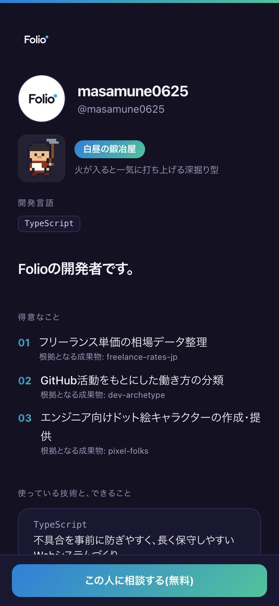
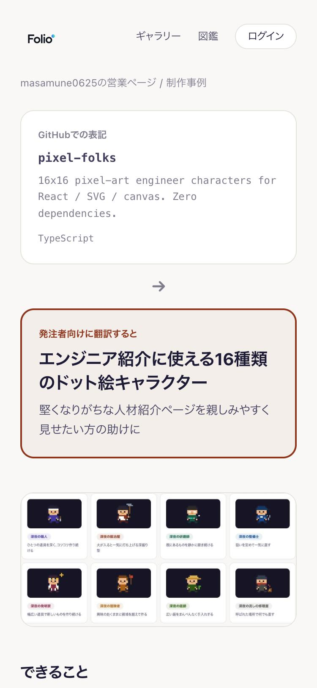

# Folio

**GitHubが、あなたの営業ページになる。**

GitHubのユーザー名を入れるだけで、エンジニアの活動を「発注者が読んで分かる言葉」に翻訳した営業ページを自動で作る無料サービスです。

[**folio.akima-inc.co.jp**](https://folio.akima-inc.co.jp) ・ [アップデート情報](https://folio.akima-inc.co.jp/updates) ・ [16タイプ図鑑](https://folio.akima-inc.co.jp/types) ・ [開発ログ(Zenn)](https://zenn.dev/masamune0625/scraps/fa5ea1f8a2f512)

> このリポジトリはFolioの紹介用です(ソースコードは非公開)。

## できること

| | |
|---|---|
| 🧾 **営業ページの自動生成** | 「TypeScript」「Next.js」のような技術の言葉を、発注者に伝わる言葉へ書き換えて、得意なことをまとめます |
| 🗂 **制作事例** | リポジトリを「解決する困りごと・できること・この経験で頼める仕事」の事例カードにします |
| 🧭 **16タイプ判定** | 活動のリズム・領域・スタイル・時間帯から、働き方を16タイプに分類します(優劣なし・ドット絵キャラつき) |
| 🪪 **READMEカード・名刺画像** | GitHubのREADME、Xのヘッダー、ココナラ・ランサーズのポートフォリオに貼れるカード |
| 📦 **プロダクトの保管庫** | 作ったものを画像・動画つきで公開。いいねが集まるとFolioが特集します |
| 📡 **案件レーダー(β)** | 受け取りをオンにした人にだけ、スキルの合う案件相談が届きます。連絡先は相談元に渡りません |

エンジニアは無料。仲介手数料もかかりません(相談・契約は当事者どうしで直接)。

## 画面

<table>
  <tr>
    <td align="center" width="25%"> 営業ページ</td>
    <td align="center" width="25%"> 制作事例</td>
    <td align="center" width="25%"> プロダクトと特集</td>
    <td align="center" width="25%"> 発注者からの相談</td>
  </tr>
</table>

READMEに貼るとこうなります(表示は自動で更新されます):

## 技術スタック

- **Next.js**(App Router)/ **TypeScript** / **Tailwind CSS v4**
- **Supabase**(Postgres・行レベルセキュリティ)/ **Vercel**
- **Claude API**: 翻訳と事例づくり。出力はツール呼び出しで型を強制し、技術用語が残ったら検出して書き直させています
- **next/og**: シェア画像・告知画像をサーバー側で生成

## 関連するOSS(MIT)

- [pixel-folks](https://github.com/masamune0625/pixel-folks) — 16タイプのドット絵キャラ(React / SVG / canvas、依存ゼロ)
- [dev-archetype](https://github.com/masamune0625/dev-archetype) — GitHubの活動から16タイプを判定するロジック
- [freelance-rates-jp](https://github.com/masamune0625/freelance-rates-jp) — 日本のフリーランスエンジニア単価相場データ(出典つきJSON)

---

English

**Folio turns a GitHub profile into a sales page that non-technical clients can understand.** Enter a GitHub username and Folio rewrites technical activity into plain, client-facing language (in Japanese): what you are good at, case studies built from your repositories, and a developer type out of 16. Free for engineers, no commission. This repository is a showcase; the source code is private.

運営: 株式会社AKIMA ・ ご相談は [作者の営業ページ](https://folio.akima-inc.co.jp/r/masamune0625) から
